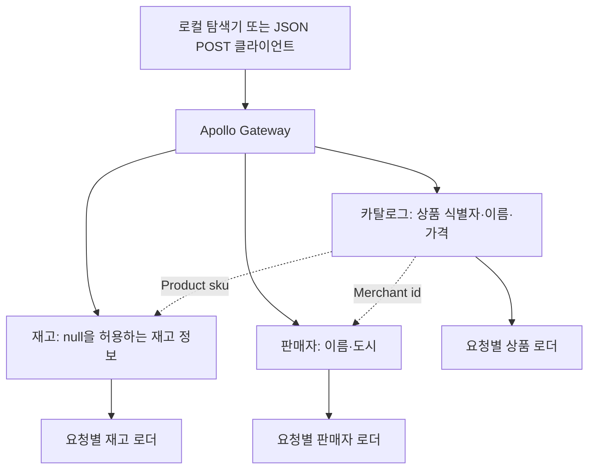

# Federation 탐색기

[English](federation-explorer.md) · [프로젝트 소개](../README.ko.md)

**하나의 조회로 세 도메인을 연결하고, 실패한 부분을 구분합니다.**

Apollo Federation 서버에서 엔티티 결합, 요청별 배칭, 부분 응답, API 호환성이 어떻게 동작하는지 살펴보는 프로젝트입니다. 로컬 탐색기에서 실제 HTTP 서브그래프를 호출하고, 테스트에서는 스키마와 의존성을 의도적으로 깨뜨립니다.

상품·판매자·오류·시간 설정은 모두 가상입니다. 회사 시스템을 재현한 작업이나 운영용 템플릿이 아니며, 실서비스 성능을 주장하지 않습니다.

## 실행하기

Node.js **24.19.0 이상인 24.x 버전**과 pnpm **11.25.0**이 필요합니다. CI는 Node.js **24.19.0**에서 검증합니다. 의존성을 설치한 뒤에는 Docker, DB, API 키, 클라우드 계정이나 외부 서비스가 필요하지 않습니다.

```sh
pnpm install --frozen-lockfile
pnpm verify
pnpm dev
```

탐색기는 **http://127.0.0.1:4181/**, GraphQL 엔드포인트는 **http://127.0.0.1:4180/** 입니다. GraphQL은 JSON POST 요청만 받습니다. 모든 서버는 루프백에 바인딩되며 세 서브그래프는 임시 포트를 사용합니다. Ctrl+C로 전체를 종료합니다.

오른쪽 위에서 한국어·영어를 전환할 수 있습니다. 언어를 바꿔도 선택 조건, 진행 중인 요청, 마지막 결과는 유지됩니다. 처음에는 브라우저 언어를 따르고 이후에는 직접 선택한 언어를 사용합니다. 다음은 한국어 화면의 옵션이며 괄호 안은 영문 이름입니다.

1. **정상 응답(Healthy)**을 실행합니다. 서브그래프 호출 세 건, 재고 배치 한 건, 서로 다른 판매자 키 두 개를 확인합니다.
2. **같은 SKU 한 번 더 조회(Repeat one SKU)**를 켭니다. 응답의 상품 위치는 네 개지만 상품·재고 로더가 조회한 고유 키는 각각 세 개입니다.
3. **의존성 오류(Dependency error)**를 선택합니다. 상품명·가격·판매자 정보는 남고, 재고는 `null`과 GraphQL 오류로 표시됩니다.
4. **응답 기한 초과(Response timeout)**를 선택합니다. 게이트웨이는 재고 응답을 더 기다리지 않고 나머지 필드를 반환합니다.
5. 같은 오류 조건에서 **카탈로그만(Catalog only)**을 선택합니다. 재고를 조회하지 않으므로 재고 오류도 발생하지 않습니다.

GraphQL 쿼리와 원본 응답·오류 메시지는 번역하지 않습니다. 가상 상품·판매자 이름도 데이터 그대로 표시합니다.

터미널만 사용하려면 `pnpm demo`를 실행합니다. 새 서버를 시작해 네 시나리오의 실제 응답을 출력한 뒤 종료합니다. 컴파일한 코드로 실행하려면 `pnpm build` 후 `pnpm start`를 사용합니다.

## 구현에서 확인할 판단

| 판단 | 확인할 근거 |
| --- | --- |
| 엔티티의 책임을 나누고 하나의 API로 결합 | `Product @key(fields: "sku")`로 카탈로그와 재고를 연결하고 `Merchant @key(fields: "id")`로 판매자 정보를 조회합니다. |
| 배칭 후에도 응답의 의미 유지 | 한 요청 안에서 중복 키를 제거해 조회하되, 응답 위치와 없는 레코드의 자리는 보존합니다. |
| 실패를 API 계약에 반영 | 재고 필드가 실패해도 유용한 데이터는 남습니다. 품절·레코드 없음·의존성 실패를 구분합니다. |
| 스키마 검사와 쿼리 검사를 함께 적용 | 합성 실패, 필드 삭제, null 허용으로의 변경, enum 값 추가를 서로 다르게 검증합니다. |
| 관측하지 못한 것은 미확인으로 표시 | `extensions.lab`에 호출 시간과 실제 로더 키를 담습니다. 타임아웃으로 받지 못한 배치 기록을 작업 0건으로 해석하지 않습니다. |
| 로컬 도구의 접근 범위 제한 | 루프백 전용 HTTP, Host·Origin 검사, 32 KiB 본문 제한, Apollo 보고·텔레메트리 비활성화를 적용합니다. |

## 구성과 실행 순서



게이트웨이는 저장소의 SDL을 합성한 supergraph를 사용합니다. 실행 중인 서브그래프를 introspection해 검증하지 않은 스키마를 받아오지 않습니다. 조회 시 카탈로그 응답이 엔티티 키를 제공하면, 재고와 판매자 서브그래프가 각 필드를 독립적으로 조회합니다. 게이트웨이와 세 서브그래프 서버는 하나의 Node 프로세스에서 실행되지만 실제 HTTP로 통신합니다.

저장소 역할은 작은 메모리 배열이 담당합니다. 배치 수는 이 코드가 작업을 묶고 중복을 제거하는 방식을 보여 줍니다. DB 성능이나 운영 처리량을 측정한 값은 아닙니다.

## 실패를 넣어 볼 쿼리

```graphql
query CatalogCards($skus: [ID!]!) {
  products(skus: $skus) {
    sku
    name
    price {
      amountMinor
      currency
    }
    merchant {
      id
      name
      city
    }
    availability {
      status
      quantity
    }
  }
}
```

변수는 `{"skus":["demo-ceramic","demo-notebook","demo-lamp"]}`를 사용합니다.

| 시나리오 | 상품 필드 | 재고 | 오류 |
| --- | --- | --- | --- |
| `healthy` | 유지 | 재고 있음 / 품절 | 없음 |
| `inventory-error` | 유지 | 세 상품 모두 `null` | 필드 경로를 포함한 `INVENTORY_UNAVAILABLE` |
| `inventory-timeout` | 유지 | 세 상품 모두 `null` | `SUBGRAPH_TIMEOUT` |
| `missing-inventory` | 유지 | 램프만 `null`, 나머지는 유지 | 없음 |

탐색기의 기본 응답 기한은 **180ms**, 주입하는 지연은 **450ms**입니다. 현상을 보여 주기 위한 설정이며 운영 권장값이나 벤치마크가 아닙니다. 탐색기에서 게이트웨이 fetch를 중단해도 서브그래프 내부 작업은 취소되지 않습니다. 별도 취소 실험은 협력적 취소를 명시적으로 연결합니다. [설계 판단](design.ko.md)과 [취소 실험의 범위](cancellation-debt.ko.md)를 함께 읽을 수 있습니다.

## 검증과 스키마 변경

```sh
pnpm typecheck   # 엄격한 TypeScript 검사
pnpm contracts  # SDL 합성, API 기준 스키마 비교, 이름 있는 쿼리 검증
pnpm test       # HTTP Federation, 실패 격리, 배칭, HTTP 경계 검증
pnpm build      # 컴파일 및 실행에 필요한 파일 복사
pnpm verify     # 위 네 단계 실행
```

테스트는 서브그래프 사이의 데이터 결합, 중복·없는 키, 요청별 캐시, 동시 요청의 오류 격리, 부분 응답, 타임아웃, 선택하지 않은 도메인의 조회 생략, 스키마 변경, HTTP 입력 제한, 서버 정리를 다룹니다. 임시 포트를 사용하며 생성한 서버는 테스트가 직접 종료합니다. 코드를 읽을 순서는 [구현 검토 안내](review-guide.ko.md)에 정리했습니다.

`schemas/api-baseline.graphql`은 검토 기준으로 저장소에 보관합니다. 계약 검사 명령이 자동으로 갱신하지 않으므로 의도적인 계약 변경도 기준 스키마 변경을 검토해야 합니다. 저장된 쿼리는 이 프로젝트의 클라이언트만 대표합니다. 모든 소비자나 동작 의미·권한 변경까지 검증하지는 않습니다.

`pnpm impact`는 메모리에서 일곱 가지 스키마 변경을 비교하고 영향을 받는 쿼리를 짚습니다. `description`을 삭제하면 `CatalogOnly`만 유효하지 않게 됩니다. 반면 `name`에 null을 허용하면 두 쿼리 모두 검증을 통과해도 API 계약은 깨집니다. `pnpm impact --format json`으로 구조화한 결과를 볼 수 있습니다. [스키마 변경과 소비자 영향](schema-evolution.ko.md)은 이 차이와 분석 범위를 설명합니다. 이 명령은 스키마를 수정하거나 배포하지 않습니다.

## 확인한 범위와 한계

- 읽기 전용 조회, 가상 상품 세 개, 단일 프로세스입니다. 영속 저장·인증·인가·트랜잭션은 구현하지 않았습니다.
- 운영 트래픽, 도입 실적, 사업 성과, 배포 성숙도를 주장하지 않습니다. 실제 요청은 로컬에서 실행하며 공개 API를 제공하지 않습니다.
- 자동 재시도는 없습니다. 재시도는 하위 작업을 늘리거나 실패를 감출 수 있으므로 사용자가 명시적으로 다시 실행합니다.
- 일반적인 쿼리 비용 제한, 호출 빈도 제한, 서킷 브레이커, 분산 취소, 영속 추적은 없습니다. SKU 12개 제한은 전체 GraphQL 복잡도 제한이 아닙니다.
- Node Gateway를 선택한 이유는 설치·확장·테스트를 하나의 런타임에서 살펴보기 위해서입니다. 모든 운영 배포에 같은 선택을 권하지 않습니다. Apollo의 Router 관련 안내는 아래 Gateway 문서에서 확인할 수 있습니다.
- 상위 의존성 권고와 로컬 노출 범위는 [보안 문서](../SECURITY.md)에 기록했습니다. 이 실험 서버를 인터넷에 공개하면 안 됩니다.

## 참고 문서

- [Apollo: 서브그래프 구현](https://www.apollographql.com/docs/apollo-server/using-federation/apollo-subgraph-setup)
- [Apollo: Federation 지시자와 엔티티 키](https://www.apollographql.com/docs/graphos/schema-design/federated-schemas/reference/directives)
- [Apollo Gateway API와 Router 안내](https://www.apollographql.com/docs/apollo-server/using-federation/api/apollo-gateway)
- [Apollo: 공개 HTTP 통합 API](https://www.apollographql.com/docs/apollo-server/integrations/building-integrations)
- [DataLoader: 배칭과 요청별 캐시](https://github.com/graphql/dataloader)
- [Node.js: AbortSignal.timeout](https://nodejs.org/docs/latest-v24.x/api/globals.html#static-method-abortsignaltimeoutdelay)

직접 작성한 코드는 [MIT 라이선스](../LICENSE)로 제공합니다. 의존성에는 각각의 라이선스가 적용됩니다.
