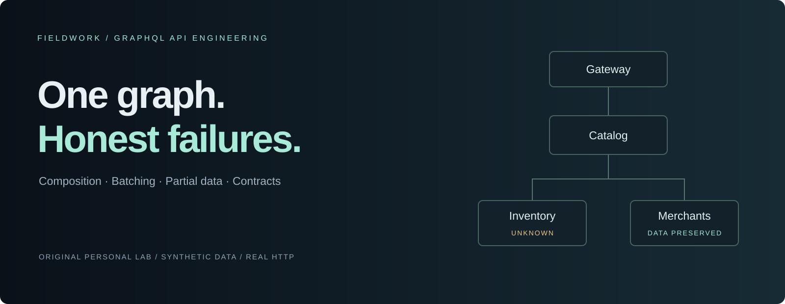
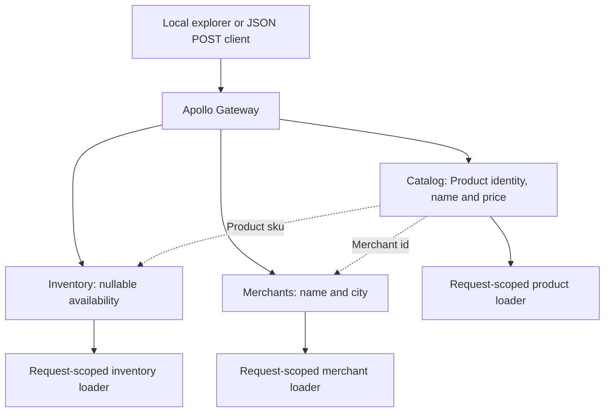

# The federation explorer

[한국어](federation-explorer.ko.md) · [Cancellation Debt](../README.md)

**One query. Three domains. Failures you can inspect.**

A small Apollo Federation server project that makes entity composition, request-scoped batching, partial responses and API compatibility tangible. It includes a local interactive explorer, real HTTP subgraphs and tests that deliberately break the graph.



All products, merchants, faults and timing thresholds are invented. This is an original personal lab, not a reproduction of an employer's systems, a production template or a performance claim.

## Run the explorer

Requires **Node.js 24** and **pnpm 11.25.0**. No Docker, database, API key, cloud account or external service is needed after dependency installation.

```sh
pnpm install --frozen-lockfile
pnpm verify
pnpm dev
```

Open **http://127.0.0.1:4181/**. The GraphQL endpoint is **http://127.0.0.1:4180/** and accepts JSON POST requests. All listeners bind to loopback; the three subgraphs use ephemeral ports. Stop the whole lab with Ctrl+C.

1. Run **Healthy**. Inspect three subgraph fetches, one inventory batch and two distinct merchant keys.
2. Enable **Repeat one SKU**. Four product positions survive, while loaders fetch three unique product/inventory keys.
3. Select **Dependency error**. Names, prices and merchants remain; availability becomes unknown with explicit GraphQL errors.
4. Select **Response timeout**. The gateway stops waiting for inventory and preserves the other fields.
5. Select **Catalog only**. The same inventory fault causes no error because inventory is not fetched.

For a terminal-only walkthrough, run `pnpm demo`. It starts fresh servers, prints four real responses and stops them. For compiled execution, run `pnpm build` followed by `pnpm start`.

## What this demonstrates

| Decision                                         | Evidence to inspect                                                                                                            |
| ------------------------------------------------ | ------------------------------------------------------------------------------------------------------------------------------ |
| Entity boundaries compose into one API           | `Product @key(fields: "sku")` joins catalog and inventory; `Merchant @key(fields: "id")` supplies merchant details             |
| Batching preserves semantics                     | Duplicate keys are deduplicated inside one request; result positions and missing records stay aligned                          |
| Failure is part of the product contract          | Nullable inventory preserves useful data; sold out, missing records and dependency failure remain distinct                     |
| Schema checks and query checks are complementary | Tests distinguish composition errors, removed fields, weakened nullability and enum additions                                  |
| Observability has limits                         | Per-fetch timings and actual loader keys appear in `extensions.lab`; timed-out responses do not invent missing batch telemetry |
| Local tooling can have a narrow boundary         | Loopback-only HTTP, strict Host/Origin checks, a 32 KiB body limit and explicit telemetry opt-out                              |

## A compact architecture



The gateway uses a supergraph composed from checked-in SDL. It does not introspect running subgraphs to discover an unchecked schema. At runtime, the catalog fetch supplies representations for later entity fetches. Inventory and merchant fields can then resolve independently. The gateway and three subgraph servers share one Node process, but communicate over actual HTTP.

The stores are small in-memory arrays, not simulated databases. Batch counts prove how this code schedules and deduplicates work; they do **not** measure database performance or production capacity.

## An operation worth breaking

```graphql
query CatalogCards($skus: [ID!]!) {
  products(skus: $skus) {
    sku
    name
    price {
      amountMinor
      currency
    }
    merchant {
      id
      name
      city
    }
    availability {
      status
      quantity
    }
  }
}
```

Variables: `{"skus":["demo-ceramic","demo-notebook","demo-lamp"]}`.

| Scenario            | Product fields | Inventory                            | Errors                                    |
| ------------------- | -------------- | ------------------------------------ | ----------------------------------------- |
| `healthy`           | Present        | In stock / sold out                  | None                                      |
| `inventory-error`   | Present        | `null` for all three                 | `INVENTORY_UNAVAILABLE`, with field paths |
| `inventory-timeout` | Present        | `null` for all three                 | `SUBGRAPH_TIMEOUT`                        |
| `missing-inventory` | Present        | Lamp is `null`; other records remain | None                                      |

The original explorer's default timeout is an intentionally small **synthetic 180 ms deadline**, with a 450 ms injected delay. These are demonstration settings, not recommended production values or benchmark results. Its default aborted gateway fetch does not cancel work inside the subgraph. The separate cancellation experiment explicitly wires cooperative cancellation; see [design decisions](design.md) and [its boundaries](cancellation-debt.md).

## Verification

```sh
pnpm typecheck   # Strict TypeScript
pnpm contracts   # Compose SDL; compare API baseline; validate named operations
pnpm test        # HTTP federation, failure isolation, batching and HTTP boundary tests
pnpm build       # Compile code and copy runtime assets
pnpm verify      # All four checks
```

The suite covers real cross-subgraph data, duplicate/unknown keys, request cache isolation, concurrent faults, partial data, timeouts, unselected-domain avoidance, schema changes, HTTP input restrictions and server cleanup. Tests use ephemeral ports and close their own listeners. [Review guide](review-guide.md) lists a short path through the implementation.

`schemas/api-baseline.graphql` is deliberately checked in. The contract command never updates it automatically: an intentional contract change requires a reviewed baseline update. Named operations cover the bundled clients, not every possible consumer. Semantic changes and authorization changes remain outside schema validation.

Run `pnpm impact` to compare seven in-memory schema changes and identify the affected named consumers. For example, removing `description` invalidates only `CatalogOnly`, while weakening `name` nullability breaks the API contract even though both queries still validate. `pnpm impact --format json` produces a structured report. See [schema evolution and consumer impact](schema-evolution.md) for the distinctions and limits; this experiment does not modify or deploy a schema.

## Scope and limits

- Read-only queries, three fixtures, one process, no persistence, authentication, authorization or transactions.
- No claim of production traffic, adoption, business impact or deployment maturity.
- The explorer runs real requests locally; it is not a publicly hosted API.
- No automatic retries: retries can multiply downstream work and hide failures. The user can rerun a query explicitly.
- No full query-cost controls, rate limits, circuit breakers, distributed cancellation or durable tracing. A 12-SKU bound is not a general GraphQL complexity limit.
- Apollo recommends GraphOS Router for supergraphs. This lab intentionally uses the Node gateway to keep setup, customization and tests inspectable in one runtime. It does not recommend that choice for every deployment.
- Upstream dependency advisories and the current local exposure assessment are recorded in [security notes](../SECURITY.md). Do not expose this lab on the public internet.

## References

- [Apollo: implementing a subgraph](https://www.apollographql.com/docs/apollo-server/using-federation/apollo-subgraph-setup)
- [Apollo: Federation directives and entity keys](https://www.apollographql.com/docs/graphos/schema-design/federated-schemas/reference/directives)
- [Apollo Gateway API and router guidance](https://www.apollographql.com/docs/apollo-server/using-federation/api/apollo-gateway)
- [Apollo: public HTTP integration API](https://www.apollographql.com/docs/apollo-server/integrations/building-integrations)
- [DataLoader: batching and request-scoped caching](https://github.com/graphql/dataloader)
- [Node.js: AbortSignal.timeout](https://nodejs.org/docs/latest-v24.x/api/globals.html#static-method-abortsignaltimeoutdelay)

Original source is available under the [MIT License](../LICENSE). Dependencies retain their own licenses.
