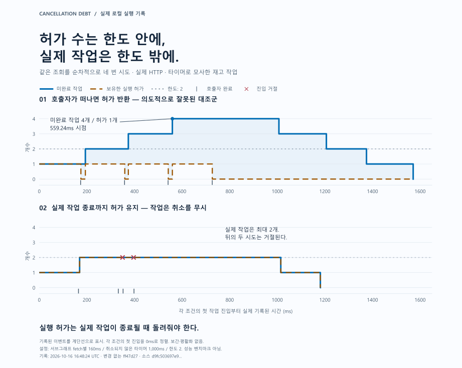

# 슬롯 수는 한도 안에, 실제 작업은 한도 밖에

[English](observed-trace.md) · [Cancellation Debt](../README.ko.md)

제한기가 작업에 배정하는 자리를 **실행 슬롯(permit)**이라 부릅니다. 일부러 잘못 구현한 제한기에서 점유 중인 슬롯은 최대 **1개**였지만, 미완료 작업은 **4개**까지 겹쳤습니다. 설정한 한도는 2개였습니다. 아래 그림은 정상으로 보이는 카운터와 실제로 제한해야 할 작업을 분리해서 보여줍니다.



위쪽 기록의 네 번째 작업은 **첫 작업 진입 후 559.24ms**에 시작합니다. 응답을 기다리던 연결이 사라졌다는 이유로 슬롯을 반환하면, 이전 작업이 계속되는 동안 다음 시도가 들어올 수 있습니다. 아래쪽에서도 하위 작업은 취소를 무시합니다. 하지만 실제 작업 종료까지 슬롯을 유지하므로 작업은 최대 2개로 제한됩니다. 그 자리가 비기 전의 두 시도는 거절됩니다.

**실행 슬롯은 실제 작업이 종료될 때 반환해야 합니다.** 협력적 취소는 하위 작업이 지원할 때만 종료를 앞당길 수 있습니다. 같은 저장 기록의 협력적 취소 조건에서는 최대 동시 작업이 1개였고, 네 시도 모두 전달된 기한을 통해 취소됐습니다. 이 기록에서 모든 연결 종료 경로가 실행됐다는 뜻은 아닙니다.

## 그림의 근거

**2026-10-16T16:48:24.068Z**, 변경 사항이 없는 `ff47d27ac38071cf7d1c611492b55f657d8d0a27`에서 저장한 과거 로컬 실행 기록입니다. 실제 HTTP에 타이머로 모사한 작업을 연결했습니다. 같은 조회를 순차적으로 네 번 시도하고, 서브그래프 fetch별 160ms 제한, 취소되지 않으면 1,000ms 동안 유지되는 타이머, 실행 한도 2개를 설정했습니다. 성능 벤치마크나 사용자 요청 전체의 응답 시간 보장이 아닙니다.

각 조건의 첫 작업 진입을 0ms로 맞추고, 기록된 이벤트 순서와 카운터를 계단선으로 표시했습니다. 보간하거나 평활화한 값은 없습니다. 아래의 짧은 눈금은 호출자 완료, 십자 표시는 진입 거절입니다. 올바른 조건에서 작업 수와 슬롯 수가 겹치는 것은 의도된 결과입니다. 각 선은 해당 조건의 마지막 기록에서 끝납니다. 시간은 원본에 기록된 0.01ms 정밀도까지만 표현합니다.

[원본 보고서](observed-trace/recording/report.json) · [기록 식별 정보와 해시](observed-trace/recording/provenance.json) · [취소 전달과 한계](cancellation-debt.ko.md)

검사기는 관측된 이벤트를 검증하며 기록되지 않은 작업까지 증명하지 않습니다. 단일 프로세스의 이 기록은 DB 취소, CPU 작업 중단, 롤백, 여러 복제본의 실행 한도나 실서비스 처리량을 입증하지 않습니다. 소스 해시는 재현을 돕지만 실행의 진위를 인증하지는 않습니다. 기록의 소스 지문은 당시 소스를 가리키며, 이후 추가한 이 문서를 가리키지 않습니다.

## 그림 재생성

저장소 루트에서 Python 3.11 이상 환경으로 실행합니다.

```sh
python -m pip install -r docs/observed-trace/requirements.txt
python docs/observed-trace/render.py
```

스크립트는 자신의 위치를 기준으로 저장된 보고서를 읽고, 고정한 원본 해시와 리비전을 확인한 뒤 그림을 만듭니다. 네트워크 요청은 하지 않습니다. 설치된 한국어 글꼴인 Noto Sans CJK KR, Noto Sans KR, Malgun Gothic, Apple SD Gothic Neo 중 하나가 필요합니다. 다른 글꼴은 `--korean-font "Family Name"`으로 지정할 수 있으며, 글꼴을 찾지 못하면 명시적으로 실패합니다. 글꼴·라이브러리 차이로 SVG 바이트는 달라질 수 있지만 표시하는 데이터는 같습니다. 실험을 재실행하는 명령이 아닙니다. SVG에는 글자 윤곽이 포함되어 있어 열람할 때 글꼴을 내려받을 필요가 없습니다.
