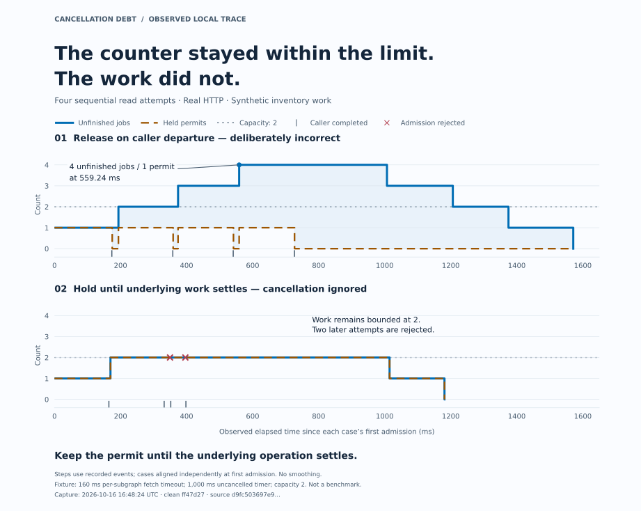

# A bounded counter can hide excess work

[한국어](observed-trace.ko.md) · [Cancellation Debt](../README.md)

The deliberately incorrect limiter held at most **one permit**, while **four unfinished jobs** overlapped. Its capacity was two. The plot below separates the count that looked safe from the work it was supposed to bound.



The fourth job in the upper trace starts **559.24 ms after the first admission**. Releasing a permit when the waiting connection disappears lets another attempt enter even though the previous work continues. In the lower trace, the dependency still ignores cancellation, but the permit remains owned until the operation settles. Actual work stays bounded at two; two later attempts are rejected while those slots remain occupied.

**Keep the permit until the underlying operation settles.** Cooperative cancellation can make settlement happen sooner only when the dependency supports it. In the same saved run, the cooperative control reached one active job and cancelled all four attempts through the forwarded deadline path. That does not establish that every disconnect path fired in this capture.

## What the picture records

This is a historical local capture from clean revision `ff47d27ac38071cf7d1c611492b55f657d8d0a27`, generated at **2026-10-16T16:48:24.068Z**. It uses real HTTP around synthetic timer work. The fixtures were four sequential read attempts, a 160 ms timeout per subgraph fetch, a 1,000 ms uncancelled timer, and capacity two. These are settings, not a benchmark or an end-to-end latency promise.

Each panel subtracts its first admission time from the original event timestamps. Steps preserve event order and recorded counters; no smoothing or invented samples are used. Small ticks mark caller completion, crosses mark rejected admission, and the two counters overlap in the correct control. Lines stop at each case's last recorded event. Derived timestamps retain the recording's two decimal places.

[Raw report](observed-trace/recording/report.json) · [Capture identity and hashes](observed-trace/recording/provenance.json) · [Protocol and limitations](cancellation-debt.md)

The event checker trusts instrumentation coverage. This single-process trace does not establish database cancellation, CPU preemption, rollback, cross-replica capacity, or production throughput. Source hashes support reproduction, not execution attestation. The capture's source fingerprint describes the historical source, not these subsequently added documents.

## Regenerate the figures

From the repository root, using Python 3.11 or newer in a Python environment:

```sh
python -m pip install -r docs/observed-trace/requirements.txt
python docs/observed-trace/render.py
```

The renderer reads the committed recording through paths relative to its own file and verifies the pinned raw hash and revision before drawing. It makes no network requests. It requires an installed Korean font: Noto Sans CJK KR, Noto Sans KR, Malgun Gothic or Apple SD Gothic Neo; another family can be selected with `--korean-font "Family Name"`. Missing fonts fail explicitly. Font/library differences can change SVG glyph bytes without changing the data; the recorded run is not rerun. The SVGs embed glyph paths and need no font download when viewed.
