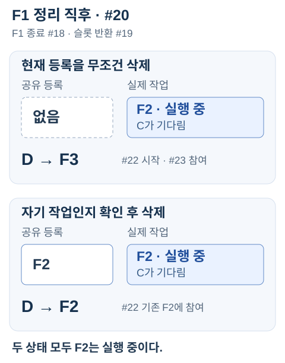

# 재고 응답은 정상이었지만, 같은 조회가 따로 실행됐다

[English](shared-work.md) · [Cancellation Debt](cancellation-debt.ko.md)

서로 다른 HTTP 요청이 하나의 실행을 함께 기다릴 수 있다. 여기서는 이 공유 실행을 *flight*라고 부른다. 이때 세 가지 수명을 구분해야 한다.

- **요청의 대기:** 각 요청이 결과를 기다리는 동안.
- **실제 작업:** 하위 작업이 실제로 끝날 때까지.
- **공유 등록:** 새 요청이 해당 작업을 찾아 참여할 수 있는 동안.

셋이 동시에 끝날 필요는 없다. 이 실험은 마지막 요청이 떠나면 공유 등록을 없애고 취소를 요청한다. 동시 실행 슬롯(permit)은 작업이 실제로 끝난 뒤에야 반환한다. 빈 슬롯이 있으면 같은 키로 새 작업을 시작할 수 있다.

`pnpm shared-work`는 고정 대조 4개를 `.local/shared-work-*.json`에 저장한다. 종료 코드 0은 잘못된 정책의 반례까지 예상대로 관측했다는 뜻이다. [실행 기록](shared-work/recording.json).

2026-10-17, 변경 사항이 없는 [b5b124c](https://github.com/minjae-lee-kr/federated-catalog-lab/tree/b5b124c32c9eff395fbd7c929dcf2c709bb3cdc0)에서 Node 24.19.0 / Windows로 기록했다. 이후 문서 수정과 별개로 이 실행 기록은 보존한다.

## 이전 작업의 정리 코드가 새 작업의 등록을 지웠다

실행 기록에서 작업 교체는 다음 순서로 진행됐다.

1. A와 B가 F1을 함께 기다리다가 둘 다 취소한다. 서버에서도 두 요청의 이탈을 확인한다.
2. F1의 등록을 없애고 취소를 요청한다. F1은 아직 실행 중이다.
3. C가 도착해 같은 키로 F2를 시작한다.
4. F1이 끝나고 정리 코드가 실행된다. 현재 등록된 작업은 F2다.
5. F2가 실행 중인 동안 D가 도착한다.

두 정리 방식의 차이만 줄여 쓰면 다음과 같다.

```ts
// 잘못된 방식: 현재 등록된 작업을 무조건 지운다.
this.registry = undefined;
// 현재 등록이 자기 작업일 때만 지운다.
if (this.registry === flight) this.registry = undefined;
```

무조건 삭제하면 4번에서 F2의 등록이 사라져 D는 F3를 시작한다. 자기 작업인지 확인하면 F2가 남아 있어 D도 F2에 참여한다.

C가 F2에 참여한 이벤트는 #17이다. 이후 F1이 종료되고(#18) 슬롯을 반환했다(#19). 아래는 정리 직후(#20)의 상태와 이후 D의 참여 경로를 비교한 그림이다. **두 경우 모두 F2는 실행 중이고 C가 기다린다. 공유 등록만 다르다.**



무조건 삭제한 기록에서는 총 3개, 자기 작업인지 확인한 기록에서는 총 2개의 flight가 시작됐다. 이벤트 번호는 각 기록의 관측 순서이며 실행 시간을 나타내지 않는다.

**두 방식 모두 C와 D는 HTTP 200과 정상 `stock` 데이터를 받았고 GraphQL 오류도 없었다. A와 B는 취소됐다.** 응답의 `extensions.sharedWork.flightId`에는 각 요청이 참여한 작업이 담겼다. 별도 이벤트 기록에서는 잘못된 정리 코드가 F1을 정리하면서 F2의 등록을 지운 순간을 확인할 수 있다.

두 방식 모두 작업이 끝난 뒤 슬롯을 반환했고 슬롯 2개로 정한 동시 실행 제한도 지켰다. 응답이 정상이고 실행량이 제한 안에 있어도, 같은 작업을 계속 공유하고 있다는 뜻은 아니었다.

## 첫 요청에 전체 작업의 취소 권한을 주면

별도 대조에서는 B가 기다리는 동안 A만 떠난다. A가 F1을 취소할 수 있게 하면 B도 재고 대신 `WORK_CANCELLED` 오류를 받는다. 마지막 요청이 떠날 때만 취소하면 B는 F1의 재고 데이터를 받는다. 요청들의 signal을 [`AbortSignal.any`](https://nodejs.org/download/release/v24.19.0/docs/api/globals.html#static-method-abortsignalanysignals)로 묶어도 하나의 취소가 전체에 전달된다.

## 이 실험의 범위

기존 loopback HTTP adapter 위에서 고정된 GraphQL 조회를 실행했다. Federation gateway나 요청별 DataLoader 정책은 바꾸지 않았다. [공유 작업 코드](../src/shared-work.ts)와 [HTTP 실험 코드](../src/shared-work-experiment.ts)에서 확인할 수 있다.

일정 시간씩 기다리는 대신 이벤트를 확인하며 순서를 제어했다. 가상 작업은 종료 단계의 gate가 해제돼야 취소 여부를 확인한다. 취소 요청만으로 작업이 끝나지는 않는다. DB 취소나 성능을 측정한 실험은 아니다. 취소 중인 작업이 완전히 끝날 때까지 새 작업의 시작을 미루는 정책도 가능하다.

이 identity 검사는 이미 쓰이는 방식이다. [Go singleflight의 정리 코드](https://github.com/golang/sync/blob/v0.17.0/singleflight/singleflight.go#L145-L150)도 정리하려는 실행과 현재 등록된 실행이 같은지 확인한 뒤 삭제한다.

**같은 키라도 같은 작업은 아니다. 정리 코드는 자신이 만든 등록만 지워야 한다.**
