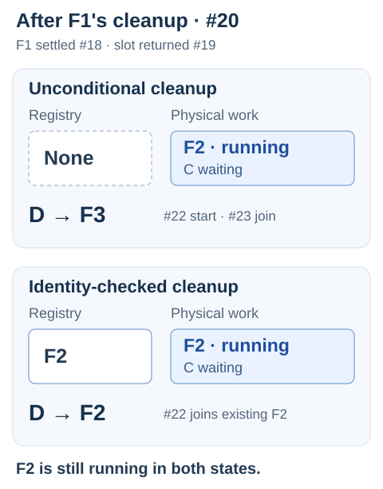

# Correct stock responses can hide duplicate work

[한국어](shared-work.ko.md) · [Cancellation Debt](cancellation-debt.md)

Two HTTP requests can wait for one execution, called a *flight*. Sharing it introduces three lifetimes:

- **Caller:** how long one request waits.
- **Physical work:** until the underlying task actually settles.
- **Registry membership:** while new callers can find and join that flight.

When the last caller leaves, this experiment detaches the flight and requests cancellation. The work holds its concurrency slot (permit) until settlement. A replacement can start if a slot is available.

`pnpm shared-work` saves four controls to `.local/shared-work-*.json`. Exit 0 means expected outcomes, including counterexamples. [Recorded run](shared-work/recording.json).

Recorded on Node 24.19.0 / Windows at clean revision [b5b124c](https://github.com/minjae-lee-kr/federated-catalog-lab/tree/b5b124c32c9eff395fbd7c929dcf2c709bb3cdc0), 2026-10-17. Later documentation changes do not alter this saved capture.

## The old cleanup removed the new registration

The recorded replacement trace follows this order:

1. A and B share F1, then both cancel. The server observes both departures.
2. F1 is detached and cancellation is requested. It remains physically active.
3. C arrives and starts F2 under the same key.
4. F1 settles. Its cleanup now encounters F2's registration.
5. D arrives while F2 is still running.

Alternative cleanup rules, simplified:

```ts
// Wrong: clear whichever flight is registered.
this.registry = undefined;
// Clear only this flight's registration.
if (this.registry === flight) this.registry = undefined;
```

At step 4, unconditional cleanup removes F2's registration, so D starts F3. Identity-checked cleanup preserves F2 for D to join.

C joined F2 at event #17. F1 then settled (#18) and returned its slot (#19). The figure compares the state after cleanup (#20), followed by D's next decision. **F2 is still running with C waiting in both cases; only its registry membership differs.**



The unconditional trace started three flights in total; the identity-checked trace started two. Event numbers identify observations in each trace, not elapsed time.

**C and D received HTTP 200 with normal `stock` data and no GraphQL errors in both cases. A and B were cancelled.** The response's `extensions.sharedWork.flightId` identifies the flight each caller joined; the event ledger records F1 deleting F2's registration in the broken case.

Both traces retained slots until settlement and stayed within the two-slot limit. Successful responses and bounded concurrency did not establish that the work was still shared.

## The first caller cannot own everyone's cancellation

A separate trace keeps B waiting while A leaves. Giving A cancellation authority over F1 produces `WORK_CANCELLED` for B. With cancellation tied to the last departure, B receives stock from F1. Combining caller signals with [`AbortSignal.any`](https://nodejs.org/download/release/v24.19.0/docs/api/globals.html#static-method-abortsignalanysignals) would still cancel on any caller's abort.

## What this demonstrates

This is a fixed GraphQL fixture using the existing loopback HTTP adapter. It changes neither the Federation gateway nor request-scoped DataLoaders. See the [coordinator](../src/shared-work.ts) and [HTTP experiment](../src/shared-work-experiment.ts).

Event barriers select the ordering without sleep-based scheduling. The synthetic task checks cancellation only when its terminal gate is released; an abort does not itself settle the work. This is not a database-cancellation or performance measurement. Another valid policy is to delay replacement until the retiring work settles.

The identity check is established practice: [Go's singleflight cleanup](https://github.com/golang/sync/blob/v0.17.0/singleflight/singleflight.go#L145-L150) also checks which call remains registered before removing it.

**Cleanup must remove its own registration, not whichever execution now occupies the same key.**
